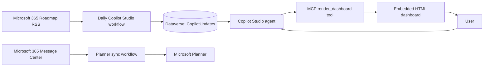
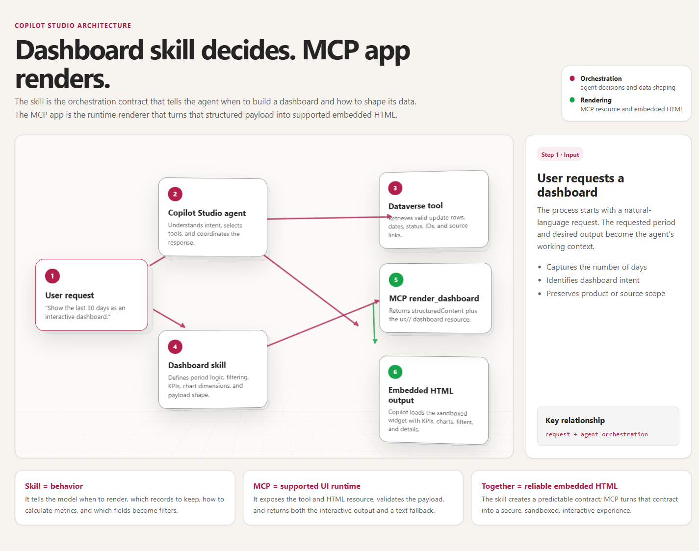
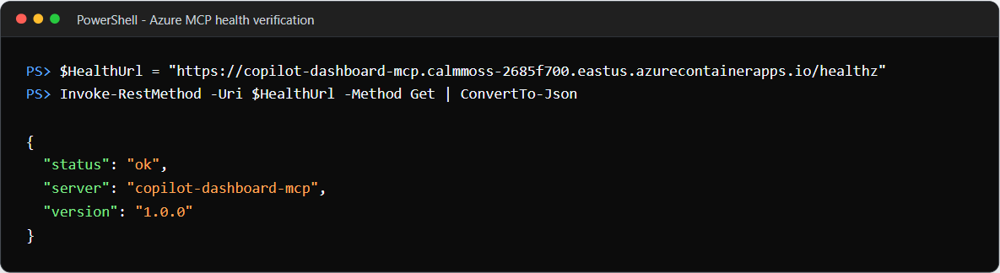
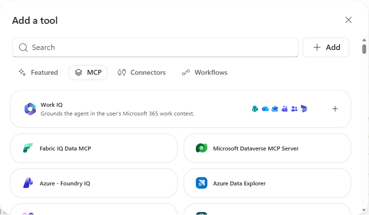
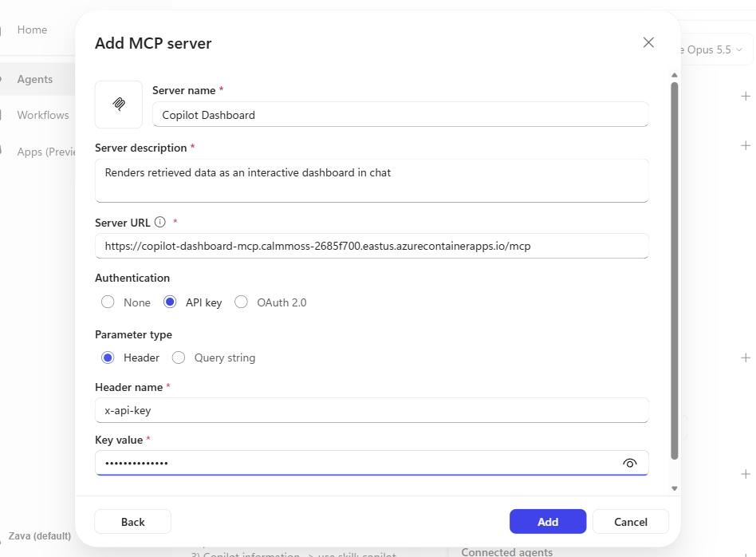
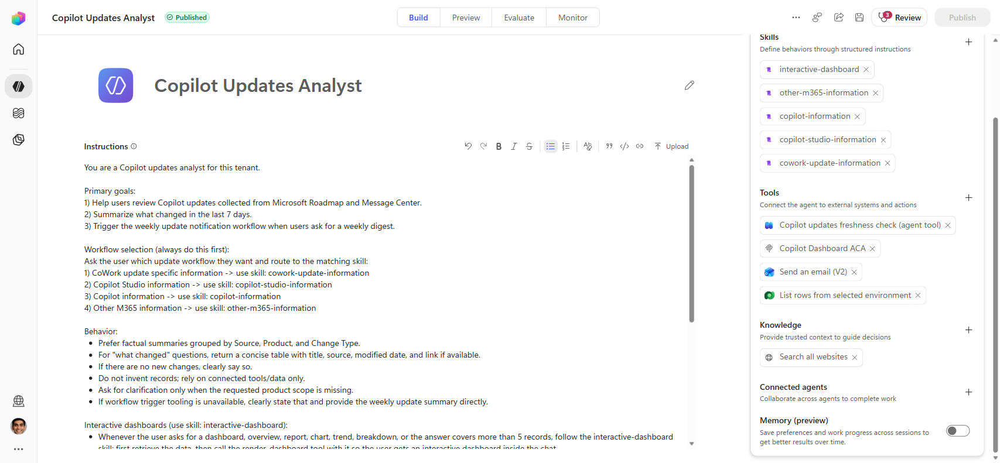
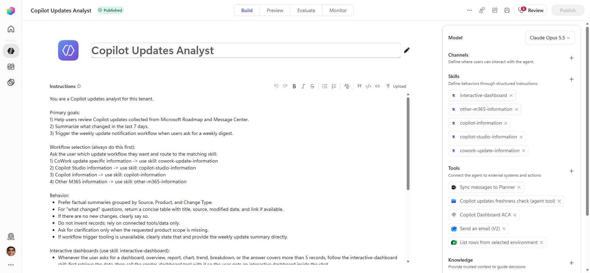
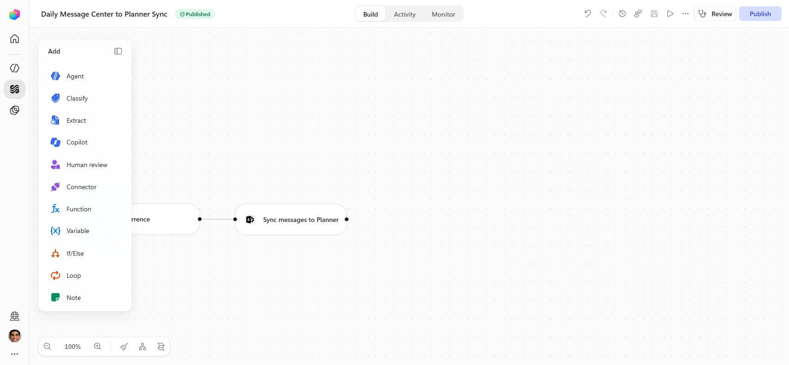

# Build a Copilot Updates Analyst with Copilot Studio, Dataverse, and an MCP HTML Dashboard

> **End-to-end lab guide:** deploy an MCP app to Azure, create a Dataverse update store, automate Microsoft 365 Roadmap ingestion, configure a Copilot Studio agent and dashboard skill, test the complete solution, and publish the agent.

## Contents

1. [Scenario and outcome](#1-scenario-and-outcome)
2. [Solution architecture](#2-solution-architecture)
3. [Prerequisites](#3-prerequisites)
4. [Lab 1: Download and test the MCP app locally](#4-lab-1-download-and-test-the-mcp-app-locally)
5. [Lab 2: Deploy the MCP app to Azure Container Apps](#5-lab-2-deploy-the-mcp-app-to-azure-container-apps)
6. [Lab 3: Add the MCP server to Copilot Studio](#6-lab-3-add-the-mcp-server-to-copilot-studio)
7. [Lab 4: Create the Dataverse update table](#7-lab-4-create-the-dataverse-update-table)
8. [Lab 5: Build the daily Roadmap ingestion workflow](#8-lab-5-build-the-daily-roadmap-ingestion-workflow)
9. [Lab 6: Make Dataverse available to the agent](#9-lab-6-make-dataverse-available-to-the-agent)
10. [Lab 7: Configure the dashboard skill and agent instructions](#10-lab-7-configure-the-dashboard-skill-and-agent-instructions)
11. [Lab 8: Configure Message Center to Planner sync](#11-lab-8-configure-message-center-to-planner-sync)
12. [Lab 9: Run the end-to-end test plan](#12-lab-9-run-the-end-to-end-test-plan)
13. [Lab 10: Publish and use the agent](#13-lab-10-publish-and-use-the-agent)
14. [Build checklist](#14-build-checklist)

---

## 1. Scenario and outcome

Microsoft publishes Copilot changes across the Microsoft 365 Roadmap, Message Center, and official announcement channels. This lab creates a single Copilot Studio agent that:

- stores normalized update records in Dataverse;
- answers questions for a user-selected time window;
- renders KPI cards, charts, filters, and a detail table as embedded HTML;
- lets users open and inspect individual updates;
- supports operational follow-up through Planner;
- provides a text fallback in channels that cannot render the embedded app.

At the end of the lab, a user can ask:

> Show Copilot updates from the last 30 days as an interactive dashboard.

The agent retrieves matching Dataverse rows and calls the MCP tool `render_dashboard`. Copilot displays the returned dashboard as a sandboxed HTML app.

---

## 2. Solution architecture



### Component responsibilities

| Component | Responsibility |
|---|---|
| Copilot Studio agent | Understands the request, selects a time window, retrieves data, and calls tools |
| Dataverse | Stores update records with consistent source, ID, status, date, and description fields |
| Ingestion workflow | Runs daily, reads the Roadmap feed, rejects blank items, and writes valid rows |
| MCP server | Exposes `render_dashboard` and its HTML UI resource through Streamable HTTP |
| Dashboard widget | Renders KPIs, charts, search, filters, time-window controls, and detail rows |
| Planner sync | Converts selected Message Center changes into operational tasks |

### How the dashboard skill and MCP app work together

The two components are complementary:

| Component | What it controls | What it does not do |
|---|---|---|
| `interactive-dashboard` skill | Decides when to render, selects the period, filters records, defines KPIs/charts, and shapes the tool arguments | It does not execute HTML or host a user interface |
| `render_dashboard` MCP tool | Validates the arguments, returns `structuredContent`, declares the `ui://` resource, and supplies a text fallback | It does not retrieve Dataverse records or decide which business data to show |
| `dashboard.html` MCP resource | Renders the supplied data as interactive, sandboxed HTML | It does not independently query Microsoft 365 or Dataverse |

The runtime sequence is:

1. The user requests a dashboard and provides, or is asked for, a time window.
2. The Copilot Studio agent retrieves update rows from Dataverse.
3. The dashboard skill instructs the agent to remove invalid rows and calculate the dashboard payload.
4. The agent calls `render_dashboard` with KPIs, charts, table rows, filters, and notes.
5. The MCP server returns the validated payload as `structuredContent` and points the host to `ui://copilot-dashboard/dashboard.html`.
6. Copilot loads the HTML resource in a sandboxed iframe and displays the interactive dashboard.

<p align="center">
  <a href="./architecture/dashboard-skill-mcp-relationship.html">
    
  </a>
</p>
<p align="center"><sub>Dashboard skill = behavior contract. MCP app = supported rendering runtime. Select the image to open the interactive HTML source.</sub></p>

> [!TIP]
> Download [`dashboard-skill-mcp-relationship.html`](./architecture/dashboard-skill-mcp-relationship.html) and open it in a browser for the interactive 3D view. Select any component to inspect its responsibility.

### Embedded HTML requirements

Embedded HTML does not work by placing HTML or JavaScript in an agent message. Copilot displays that content as text. The supported pattern used in this lab is:

1. The MCP tool declares `_meta.ui.resourceUri`.
2. The MCP server exposes the corresponding `ui://` HTML resource.
3. The tool returns `structuredContent` containing dashboard data.
4. The Copilot host loads the UI resource in a sandboxed iframe.
5. The widget renders the `structuredContent`.

The included MCP app performs all five steps.

> [!NOTE]
> The embedded view is designed for Microsoft 365 Copilot and Copilot Studio test chat. Channels without MCP Apps rendering receive the Markdown summary returned by the same tool.

---

## 3. Prerequisites

### 3.1 Required access

- Azure subscription with permission to create resource groups and Container Apps
- Copilot Studio environment with Dataverse
- Permission to create tables and workflows in that environment
- Permission to create and publish a Copilot Studio agent
- Microsoft 365 Message Center and Planner access for the optional Planner lab

### 3.2 Required local tools

Install:

- [Git](https://git-scm.com/downloads)
- [Python 3.10 or later](https://www.python.org/downloads/)
- [Node.js](https://nodejs.org/) for widget tests
- [Azure CLI](https://learn.microsoft.com/cli/azure/install-azure-cli-windows)
- PowerShell 7 or Windows PowerShell 5.1

Open PowerShell and verify:

```powershell
git --version
python --version
node --version
az version
$PSVersionTable.PSVersion
```

### 3.3 Select the correct Copilot Studio environment

1. Open [Copilot Studio](https://copilotstudio.microsoft.com).
2. Use the environment selector in the upper-right corner.
3. Select the environment where the Dataverse table, workflows, connections, and agent will be created.
4. Keep every object in this lab in the same environment.

<p align="center">
  
</p>
<p align="center"><sub>Confirm the target environment and agent before creating tools or workflows.</sub></p>

**Checkpoint:** You can open Copilot Studio, create an agent, and access **Workflows** in the selected environment.

---

## 4. Lab 1: Download and test the MCP app locally

The deployable app is included under [`mcp-app`](./mcp-app).

### 4.1 Clone this repository

```powershell
git clone https://github.com/ukpkumar/Copilot-Updates-Analyst-Agents-in-Copilot-Studio-with-Embedded-HTML-through-MCP-App-Concept-.git copilot-updates-analyst-lab
Set-Location .\copilot-updates-analyst-lab
```

If your local directory has a different name, change the `Set-Location` command accordingly.

### 4.2 Review the app structure

```text
mcp-app/
├── server.py                         # MCP Streamable HTTP server
├── widget/dashboard.html             # Embedded HTML dashboard
├── preview.html                      # Browser preview
├── Dockerfile                        # Container image definition
├── deploy/
│   ├── azure-container-apps.ps1      # Windows deployment
│   └── azure-container-apps.sh       # Bash deployment
├── scripts/
│   └── build_mcp_messages_payload.py # Optional payload generator
└── tests/
    ├── test_server.py                # MCP protocol tests
    └── widget_logic_test.js          # Widget behavior tests
```

### 4.3 Run the server tests

```powershell
Set-Location .\mcp-app
python .\tests\test_server.py
node .\tests\widget_logic_test.js
```

Both commands must complete successfully before deployment.

### 4.4 Run the MCP server locally

Create a temporary development key and start the server:

```powershell
$env:MCP_API_KEY = "local-development-key"
python .\server.py
```

Leave that PowerShell window open. The server listens on:

- MCP: `http://localhost:8000/mcp`
- Health: `http://localhost:8000/healthz`

### 4.5 Verify the local health endpoint

Open a second PowerShell window:

```powershell
Invoke-RestMethod -Uri "http://localhost:8000/healthz"
```

### 4.6 Verify MCP initialization

```powershell
$headers = @{
    "x-api-key" = "local-development-key"
    "Accept" = "application/json"
}

$body = @{
    jsonrpc = "2.0"
    id = 1
    method = "initialize"
    params = @{
        protocolVersion = "2025-06-18"
        capabilities = @{}
        clientInfo = @{
            name = "PowerShell lab client"
            version = "1.0"
        }
    }
} | ConvertTo-Json -Depth 10

Invoke-RestMethod `
    -Uri "http://localhost:8000/mcp" `
    -Method Post `
    -Headers $headers `
    -ContentType "application/json" `
    -Body $body
```

**Checkpoint:** The response contains MCP server information rather than an authentication or connection error.

---

## 5. Lab 2: Deploy the MCP app to Azure Container Apps

### 5.1 Sign in and select a subscription

```powershell
az login
az account list --output table
az account set --subscription "<subscription-name-or-id>"
az account show --output table
```

### 5.2 Install the Container Apps CLI extension

```powershell
az extension add --name containerapp --upgrade
az provider register --namespace Microsoft.App
az provider register --namespace Microsoft.OperationalInsights
```

### 5.3 Define deployment values

Choose globally unique and tenant-appropriate names:

```powershell
$ResourceGroup = "rg-copilot-dashboard-mcp"
$Location = "eastus"
$AppName = "copilot-dashboard-mcp"

$keyBytes = New-Object byte[] 32
$rng = [System.Security.Cryptography.RandomNumberGenerator]::Create()
$rng.GetBytes($keyBytes)
$rng.Dispose()
$ApiKey = -join ($keyBytes | ForEach-Object { $_.ToString("x2") })
```

Do not print, capture, or commit `$ApiKey`.

### 5.4 Run the deployment script

From the repository root:

```powershell
Set-Location .\mcp-app

.\deploy\azure-container-apps.ps1 `
    -ResourceGroup $ResourceGroup `
    -Location $Location `
    -AppName $AppName `
    -ApiKey $ApiKey
```

The script:

1. creates or updates the resource group;
2. builds the Docker image from `mcp-app`;
3. creates an Azure Container Apps environment;
4. deploys the container with external HTTPS ingress;
5. sets `MCP_API_KEY`;
6. prints the MCP and health URLs.

### 5.5 Capture the deployed URLs

```powershell
$Fqdn = az containerapp show `
    --name $AppName `
    --resource-group $ResourceGroup `
    --query properties.configuration.ingress.fqdn `
    --output tsv

$McpUrl = "https://$Fqdn/mcp"
$HealthUrl = "https://$Fqdn/healthz"

$McpUrl
$HealthUrl
```

### 5.6 Verify the Azure deployment

```powershell
Invoke-RestMethod -Uri $HealthUrl
```

Then initialize MCP:

```powershell
$headers = @{
    "x-api-key" = $ApiKey
    "Accept" = "application/json"
}

$body = @{
    jsonrpc = "2.0"
    id = 1
    method = "initialize"
    params = @{
        protocolVersion = "2025-06-18"
        capabilities = @{}
        clientInfo = @{
            name = "Azure validation client"
            version = "1.0"
        }
    }
} | ConvertTo-Json -Depth 10

Invoke-RestMethod `
    -Uri $McpUrl `
    -Method Post `
    -Headers $headers `
    -ContentType "application/json" `
    -Body $body
```

The deployed health endpoint used for this lab returned:

<p align="center">
  
</p>
<p align="center"><sub>Live Azure verification: the Container App reports status <code>ok</code> for MCP server version 1.0.0.</sub></p>

**Checkpoint:** The health endpoint succeeds, and the authenticated MCP initialize request returns server metadata.

---

## 6. Lab 3: Add the MCP server to Copilot Studio

### 6.1 Create or open the agent

1. Open [Copilot Studio](https://copilotstudio.microsoft.com).
2. Confirm the environment from Lab 3.
3. Select **Agents**.
4. Open an existing agent, or select **New agent** and create one named **Copilot Updates Analyst**.
5. Open the agent's **Build** page.

### 6.2 Start the MCP tool wizard

1. In **Tools**, select **Add a tool**.
2. Select **New tool**.
3. Select **Model Context Protocol** or **MCP server**.

<p align="center">
  
</p>
<p align="center"><sub>Select the MCP tab in the agent's Add tool experience.</sub></p>

### 6.3 Enter the MCP server details

Use:

| Field | Value |
|---|---|
| Name | `Copilot Dashboard ACA` |
| Description | `Renders retrieved Copilot update data as an interactive dashboard.` |
| Server URL | The value of `$McpUrl` from Lab 2 |
| Authentication | API key |
| API key location | Header |
| Header name | `x-api-key` |
| Header value | The value of `$ApiKey` |

1. Enter the server name, description, and URL.
2. Select API key authentication.
3. Configure the `x-api-key` header.
4. Create the connection.
5. Select the new connection.
6. Select **Add**.

<p align="center">
  
</p>
<p align="center"><sub>Use the deployed `/mcp` URL and store the key in the connection; never place it in agent instructions.</sub></p>

### 6.4 Verify the tool

1. Return to the agent's **Tools** list.
2. Open **Copilot Dashboard ACA**.
3. Confirm that `render_dashboard` is enabled.
4. Select **Save**.

<p align="center">
  
</p>
<p align="center"><sub>The MCP server must appear in the agent's tool list.</sub></p>

**Checkpoint:** The agent tool list contains the MCP server, and `render_dashboard` is available.

---

## 7. Lab 4: Create the Dataverse update table

### 7.1 Create the table

1. Open [Power Apps](https://make.powerapps.com).
2. Select the same environment used in Copilot Studio.
3. Select **Dataverse** → **Tables**.
4. Select **New table** → **Set advanced properties**.
5. Enter:
   - Display name: `Copilot Updates`
   - Plural name: `Copilot Updates`
   - Primary column: `Title`
6. Select **Save**.

### 7.2 Add the columns

Create these columns:

| Display name | Suggested schema name | Type | Required |
|---|---|---|---|
| Title | `Title` | Text, 500 characters | Business required |
| Body | `Body` | Multiline text | Optional |
| Source | `Source` | Choice or text | Business required |
| Status | `Status` | Choice or text | Optional |
| Source ID | `SourceId` | Text, 200 characters | Business required |
| Message center ID | `MessageCenterId` | Text, 100 characters | Optional |
| Roadmap ID | `RoadmapId` | Text, 100 characters | Optional |
| Source URL | `SourceUrl` | URL | Optional |
| Modified on source | `ModifiedOnSource` | Date and time | Optional |
| Ingested on | `IngestedOn` | Date and time | Business required |
| Product | `Product` | Text, 200 characters | Optional |

If `Source` is a choice column, add:

- `Message Center`
- `Microsoft 365 Roadmap`
- `Microsoft Blog`
- `External`

If `Status` is a choice column, add:

- `In development`
- `Rolling out`
- `Generally available`
- `Unknown`

### 7.3 Add a duplicate-prevention key

1. Open the table.
2. Select **Schema** → **Keys**.
3. Select **New key**.
4. Name it `SourceAndSourceId`.
5. Select `Source` and `Source ID`.
6. Save the key and wait until its status becomes **Active**.

**Checkpoint:** The table is visible in Dataverse, all columns are present, and the alternate key is active.

---

## 8. Lab 5: Build the daily Roadmap ingestion workflow

Use the official Microsoft 365 Roadmap RSS endpoint:

```text
https://www.microsoft.com/releasecommunications/api/v2/m365/rss
```

### 8.1 Create the scheduled workflow

1. Return to [Copilot Studio](https://copilotstudio.microsoft.com).
2. Select **Workflows** in the left navigation.
3. Select **New workflow**.
4. Rename it **Daily Microsoft 365 Roadmap ingestion**.
5. Select the trigger and choose **Recurrence**.
6. Configure:
   - Frequency: `Day`
   - Interval: `1`
   - Start time: your preferred daily time
   - Time zone: your operating time zone

### 8.2 Add the RSS action

1. Select **Add a step**.
2. Search for **RSS**.
3. Select **List all RSS feed items**.
4. Create or select the RSS connection.
5. Set **RSS feed URL** to:

```text
https://www.microsoft.com/releasecommunications/api/v2/m365/rss
```

### 8.3 Add the loop

1. Select **Add a step** after the RSS action.
2. Select **Loop**.
3. Set **Loop type** to **For each**.
4. For **Array expression**, select **Body** from **List all RSS feed items**.

### 8.4 Add the blank-title guard inside the loop

1. Select **Add a step inside Loop**.
2. Select **If/Else**.
3. Configure the **If** condition:
   - Property: `item().Feed title`
   - Operator: `Not equal`
   - Value: leave empty

This condition is mandatory. It prevents blank Dataverse rows.

### 8.5 Add the Dataverse action only to the If branch

1. Under the **If** branch, select **Add a step**.
2. Search for **Microsoft Dataverse**.
3. Select **Add a new row**.
4. Select table **Copilot Updates**.
5. Map:

| Dataverse field | RSS dynamic value |
|---|---|
| Title | Feed title |
| Body | Feed summary |
| Source | `Microsoft 365 Roadmap` or `External` |
| Source ID | Feed ID |
| Roadmap ID | Feed ID |
| Source URL | Primary feed link |
| Modified on source | Feed updated on |
| Ingested on | Expression `utcNow()` |

6. Leave the **Else** branch empty. An empty Else branch skips the invalid item and continues the loop.

The required topology is:

```text
Recurrence
  → List all RSS feed items
    → Loop
      → If/Else: Feed title is not empty
        → If: Add a new Dataverse row
        → Else: no action
```

### 8.6 Save and publish the workflow

1. Select **Review**.
2. Confirm that there are no validation errors.
3. Select **Save**.
4. Select **Publish**.
5. Select **Run** to execute one manual validation run.
6. Open **Activity** and wait for the run to complete.

### 8.7 Validate Dataverse output

1. Open Power Apps.
2. Open **Copilot Updates**.
3. Select **Edit data**.
4. Sort by **Ingested on**, newest first.
5. Confirm:
   - Title is populated.
   - Source is not `System`.
   - Roadmap ID / Source ID is populated.
   - Modified on source has a real source date.
   - No blank rows were created.

**Checkpoint:** The workflow succeeds, and new Dataverse rows contain valid titles and source metadata.

---

## 9. Lab 6: Make Dataverse available to the agent

The MCP dashboard formats data; it does not retrieve Dataverse records itself. The agent therefore needs a Dataverse read tool.

### 9.1 Add the Dataverse list-rows tool

1. Open **Copilot Updates Analyst** in Copilot Studio.
2. Open **Tools**.
3. Select **Add a tool**.
4. Search for **Microsoft Dataverse**.
5. Select **List rows from selected environment**.
6. Select the connection for the lab environment.
7. Configure the tool to use the `Copilot Updates` table.
8. Add and save the tool.

### 9.2 Configure useful output fields

Ensure the tool makes these fields available:

- Title
- Body
- Source
- Status
- Source ID
- Roadmap ID
- Message center ID
- Source URL
- Modified on source
- Product

### 9.3 Confirm the tool in the agent

The agent should now have at least:

- `List rows from selected environment`
- `Copilot Dashboard ACA` / `render_dashboard`

**Checkpoint:** Both the Dataverse read tool and MCP dashboard tool are visible in the agent's tool list.

---

## 10. Lab 7: Configure the dashboard skill and agent instructions

### 10.1 Create the interactive dashboard skill

1. Open the agent's **Build** page.
2. Open **Skills**.
3. Select **Add skill** or **New skill**.
4. Name it `interactive-dashboard`.
5. Use this description:

```text
Renders Copilot update records as an embedded interactive HTML dashboard through the render_dashboard MCP tool.
```

6. Use these instructions:

```text
Use this skill whenever the user asks for a dashboard, report, chart, trend,
breakdown, update list, or summary containing more than a few records.

First determine the requested period. If the user does not provide a period,
ask for the number of days. Accept preset periods such as 7, 30, and 90 days
and any positive custom number.

Retrieve matching rows from Dataverse. Exclude rows with an empty title.
Use Modified on source as the record date and Ingested on only as a fallback.

Call render_dashboard with:
- a title that includes the selected period;
- generatedAt set to the current time;
- KPI tiles for total updates and source/status counts;
- charts using the same filter dimensions as the table;
- table columns for title, source, status, modified date, product, and URL;
- filterKeys containing source, status, and product;
- notes describing any data gap.

After rendering, summarize only the most important two to four findings.
Do not repeat the complete table in chat.
```

7. Save the skill.

### 10.2 Add core agent instructions

1. Open **Instructions** on the agent's Build page.
2. Append:

```text
You are a Copilot Updates Analyst.

For update requests:
1. Identify the requested number of days. Ask the user when it is missing.
2. Read Copilot Updates from Dataverse.
3. Remove records with empty titles.
4. Filter by Modified on source for the requested period.
5. Use the interactive-dashboard skill and render_dashboard tool.
6. Preserve source IDs, status, dates, and source links.
7. Never invent missing status, ID, date, or rollout information.
8. If no rows match, say so and offer a larger period.
```

3. Select **Save**.

<p align="center">
  
</p>
<p align="center"><sub>Instructions should require a user-defined time window and the MCP dashboard tool.</sub></p>

### 10.3 Test dashboard rendering

1. Open **Test your agent**.
2. Start a new conversation.
3. Enter:

```text
Show Copilot updates from the last 30 days as an interactive dashboard.
```

4. Confirm the agent invokes the Dataverse tool first.
5. Confirm it then invokes `render_dashboard`.
6. Confirm the embedded dashboard appears.
7. Test search, source/status filters, sorting, a time-window control, and a detail row.

<p align="center">
  
</p>
<p align="center"><sub>The MCP app renders inside the Copilot host after the agent supplies structured data.</sub></p>

**Checkpoint:** A 30-day prompt produces an embedded dashboard and a concise textual summary.

---

## 11. Lab 8: Configure Message Center to Planner sync

This workflow creates operational Planner tasks. Dataverse remains the analytical serving store.

### 11.1 Configure Message Center Planner preferences

1. Open the [Microsoft 365 admin center](https://admin.microsoft.com).
2. Go to **Health** → **Message center**.
3. Open **Preferences**.
4. Open the **Planner** or **Sync to Planner** configuration.
5. Select the target Planner plan and bucket.
6. Select which Message Center posts should create or update tasks.
7. Save the preferences.

### 11.2 Add the tool to the agent

1. Open the agent in Copilot Studio.
2. Select **Tools** → **Add a tool**.
3. Search for **Sync messages to Planner**.
4. Select the Microsoft 365 Message Center connection.
5. Add the tool and save the agent.

<p align="center">
  
</p>
<p align="center"><sub>The Message Center connector can now be used by the agent or a scheduled workflow.</sub></p>

### 11.3 Create the daily Planner workflow

1. Select **Workflows**.
2. Select **New workflow**.
3. Rename it **Daily Message Center to Planner Sync**.
4. Add a **Recurrence** trigger.
5. Configure it to run once per day.
6. Add **Sync messages to Planner**.
7. Select the Message Center connection.
8. Save and publish.

<p align="center">
  
</p>
<p align="center"><sub>The scheduled flow contains the Recurrence trigger followed by Sync messages to Planner.</sub></p>

### 11.4 Validate the workflow

1. Select **Run**.
2. Open **Activity**.
3. Confirm that the run succeeds.
4. Open the selected Planner plan.
5. Confirm that matching Message Center posts appear as tasks.

<p align="center">
  
</p>
<p align="center"><sub>Save and publish the workflow before running the validation.</sub></p>

**Checkpoint:** The workflow succeeds and matching Planner tasks are visible.

---

## 12. Lab 9: Run the end-to-end test plan

Run every test before publishing.

| ID | Procedure | Expected result |
|---|---|---|
| T01 | Open the Azure `/healthz` URL | HTTP success and healthy service response |
| T02 | Send an authenticated MCP `initialize` request | MCP server metadata is returned |
| T03 | Run daily ingestion manually | Workflow succeeds |
| T04 | Inspect newest Dataverse records | Title, source ID, source, and modified date are populated |
| T05 | Search Dataverse for blank titles | No new blank-title records exist |
| T06 | Ask for the last 30 days | Agent reads Dataverse and renders the dashboard |
| T07 | Click dashboard filters | KPIs/charts/table respond consistently |
| T08 | Open a dashboard detail row | Full item details and source link are available |
| T09 | Ask for a custom 45-day period | Dashboard is regenerated for 45 days |
| T10 | Run Planner sync | Matching Message Center tasks appear in Planner |
| T11 | Start a new conversation and repeat T06 | Behavior is consistent without prior chat context |

### 12.1 Validate tool order

In the Copilot Studio test panel:

1. Enable activity/debug details.
2. Submit the 30-day dashboard prompt.
3. Confirm the sequence:
   - Dataverse list rows
   - `render_dashboard`
   - concise summary

<p align="center">
  
</p>
<p align="center"><sub>Use the activity trace to prove that the agent retrieves data before rendering it.</sub></p>

### 12.2 Acceptance criteria

The solution is ready to publish only when:

- all required tools are connected;
- the ingestion workflow is published and successful;
- Dataverse contains valid, nonblank rows;
- the dashboard renders in test chat;
- dashboard interactions work;
- custom time windows work;
- Planner sync succeeds when included;
- Copilot Studio Review has no blocking errors.

---

## 13. Lab 10: Publish and use the agent

### 13.1 Review the agent

1. Open the agent.
2. Select **Review**.
3. Resolve every error.
4. Confirm tools use valid connections.
5. Run an evaluation if your governance policy requires one.

### 13.2 Configure channels

1. Open **Channels**.
2. Enable the Microsoft 365 Copilot channel for embedded MCP Apps rendering.
3. Complete any tenant approval steps.
4. Save the channel configuration.

### 13.3 Publish

1. Return to the agent overview.
2. Select **Publish**.
3. Confirm publication.
4. Wait for the published version to become available.

### 13.4 Run the published agent

Use prompts such as:

```text
Show Copilot updates from the last 7 days.
```

```text
Compare Copilot updates from the last 30 days by source and status.
```

```text
Show the last 90 days and let me filter by product.
```

```text
Show the last 45 days and highlight items that are rolling out.
```

For each prompt, confirm that the date range in the dashboard matches the request and the source links open the expected Microsoft item.

---

## 14. Build checklist

- [ ] Correct Copilot Studio environment selected
- [ ] Local MCP server tests passed
- [ ] Azure Container App deployed
- [ ] Health and authenticated MCP requests succeeded
- [ ] MCP server added to Copilot Studio
- [ ] `render_dashboard` enabled
- [ ] Dataverse table and columns created
- [ ] Duplicate-prevention key active
- [ ] Roadmap ingestion workflow built with blank-title guard
- [ ] Dataverse mappings populated explicitly
- [ ] Dataverse list-rows tool added to agent
- [ ] Interactive dashboard skill saved
- [ ] Agent instructions saved
- [ ] Embedded dashboard tested
- [ ] Planner preferences and workflow configured, if required
- [ ] End-to-end tests passed
- [ ] Agent Review has no blockers
- [ ] Agent published

---

## Included MCP app

The [`mcp-app`](./mcp-app) directory is the deployable reference implementation used by this lab. It exposes one read-only MCP tool:

```text
render_dashboard
```

The tool accepts KPI, chart, table, filter, and notes data; returns structured content for the widget; and also returns a Markdown summary for non-rendering channels.

### Security characteristics

- API key is read from `MCP_API_KEY`.
- The key is sent through the `x-api-key` header.
- The widget loads no third-party scripts.
- Dashboard text is HTML-escaped.
- Non-HTTP links are rejected.
- Payload limits prevent unbounded tables and charts.
- The tool formats records supplied by the agent; it does not independently access Dataverse or Microsoft 365.
