# Copilot Updates Analyst in Copilot Studio  
## End-to-End Lab Guide for Embedded HTML Dashboards via MCP (Azure + Dataverse + Workflows + Planner Sync)

This lab shows how to build a Copilot Studio agent that ingests Microsoft Copilot update signals, stores them in Dataverse, and renders an interactive embedded HTML dashboard through an MCP app.

---

## Index

1. [Agent scenario](#1-agent-scenario)
2. [What you are building](#2-what-you-are-building)
3. [Components required](#3-components-required)
4. [Embedded HTML rendering requirements](#4-embedded-html-rendering-requirements)
5. [What is an MCP app?](#5-what-is-an-mcp-app)
6. [Build the MCP app in Azure](#6-build-the-mcp-app-in-azure)
7. [Connect the MCP app to Copilot Studio](#7-connect-the-mcp-app-to-copilot-studio)
8. [Configure skills and instructions](#8-configure-skills-and-instructions)
9. [Dataverse model](#9-dataverse-model)
10. [Message Center to Planner sync](#10-message-center-to-planner-sync)
11. [Daily ingestion workflow](#11-daily-ingestion-workflow)
12. [Test cases](#12-test-cases)
13. [Publish and use the agent](#13-publish-and-use-the-agent)

---

## 1. Agent scenario

This agent helps teams track Copilot-related updates (roadmap, message center, official announcements/blogs), analyze impact, and present updates in a dashboard format that users can interact with directly inside Copilot Studio.

---

## 2. What you are building

- **Copilot Studio agent** for update analysis
- **MCP app** for interactive embedded HTML dashboard rendering
- **Dataverse-backed storage** for fast retrieval and filtering
- **Scheduled workflows** for ingestion and freshness checks
- **Planner sync workflow** for operational follow-up

---

## 3. Components required

- Azure subscription
- Azure CLI + Docker
- Azure Container Apps + Azure Container Registry
- Copilot Studio environment
- Dataverse table for updates (example: `CopilotUpdates`)
- Microsoft 365 permissions for Message Center / Planner (if Planner sync is used)

---

## 4. Embedded HTML rendering requirements

For dashboard rendering to work reliably:

1. MCP tool must return HTML artifact content, not only plain text.
2. Agent instructions must explicitly ask for dashboard output when data exists.
3. Payload should include source, title, summary, dates, IDs, and links.
4. Dashboard UI should include time-window controls (7/30/90/custom) and row drill-down.

---

## 5. What is an MCP app?

An MCP app is an external tool service your agent calls at runtime.  
In this solution, MCP is responsible for rendering rich interactive HTML dashboards (filters, charts, click-through details) that standard text responses cannot provide.

---

## 6. Build the MCP app in Azure

1. Package/build your MCP project locally.
2. Deploy to Azure Container Apps.
3. Configure API key/header authentication.
4. Validate:
   - health endpoint is reachable
   - MCP endpoint rejects unauthenticated requests
   - MCP endpoint succeeds with auth

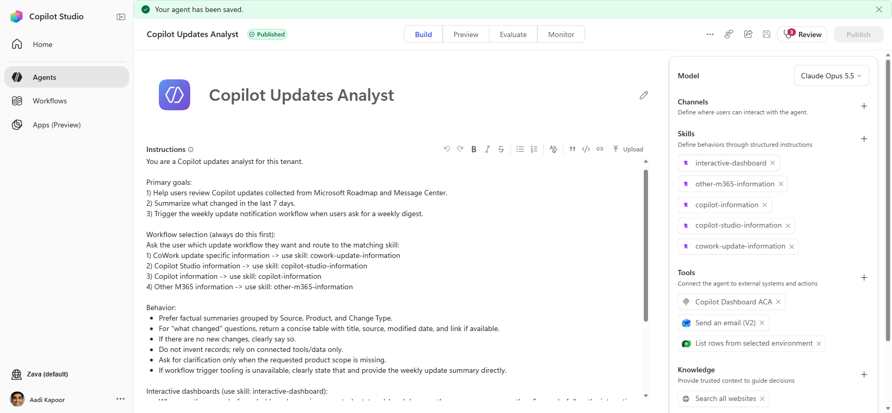

---

## 7. Connect the MCP app to Copilot Studio

1. Open your agent in **Build**.
2. Go to **Tools** → **Add tool** → **MCP server**.
3. Add MCP URL + auth header/API key.
4. Save and verify the tool appears in the tool list.

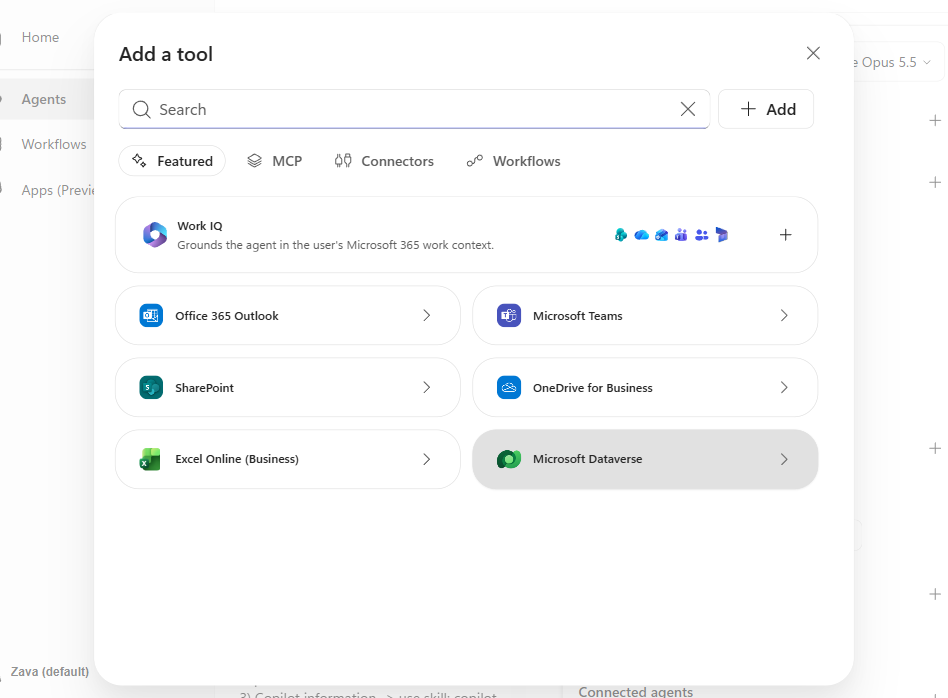
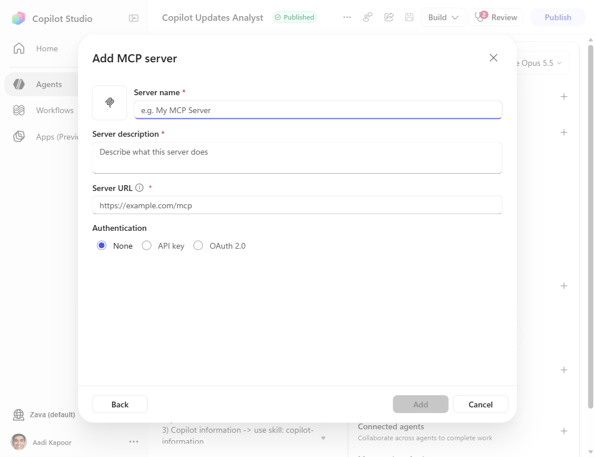
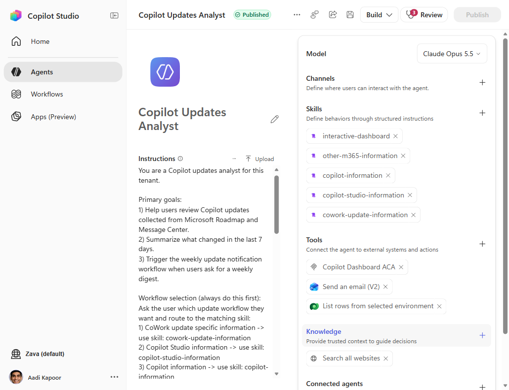

---

## 8. Configure skills and instructions

Configure the agent so it:

- prioritizes embedded dashboard output for update queries
- supports dynamic windows (7, 30, 90, and custom)
- explains source coverage clearly
- falls back to concise summary when no records exist in selected window

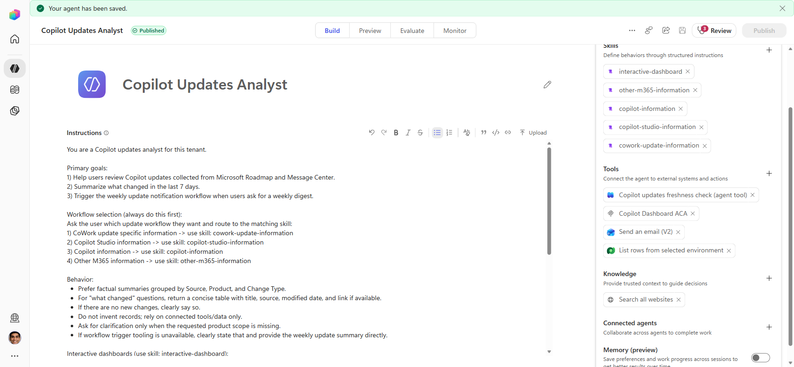
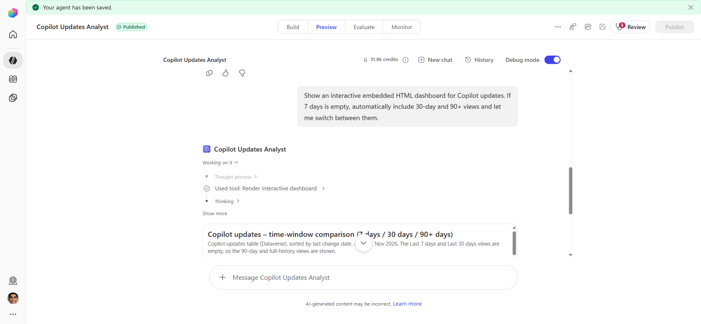

---

## 9. Dataverse model

Use Dataverse as the long-term serving layer. Recommended fields:

- `Title`
- `Body` / `Summary`
- `Source`
- `Status`
- `MessageCenterId`
- `RoadmapId`
- `SourceUrl`
- `ModifiedOnSource`
- `IngestedOn`

In ingestion logic, write only records with non-empty titles and map source/status/IDs explicitly.

---

## 10. Message Center to Planner sync

Planner sync is for operational tracking (ownership and tasking), not for replacing Dataverse analytics.

1. Add **Sync messages to Planner** tool.
2. Build a recurring workflow.
3. Validate run results and Planner task creation.

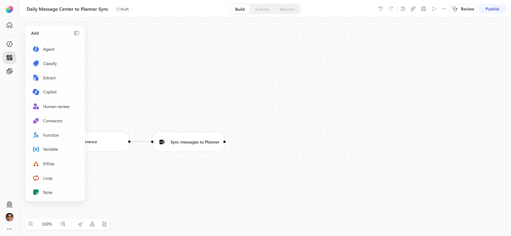

---

## 11. Daily ingestion workflow

Create a workflow that runs daily and writes normalized rows into Dataverse:

1. Trigger: **Recurrence** (daily schedule)
2. Pull source feed/items
3. Loop through items
4. If title is not empty, insert/update Dataverse row
5. Save and publish

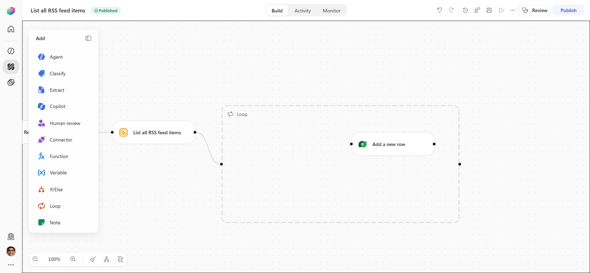

---

## 12. Test cases

| Test case | Input | Expected outcome |
|---|---|---|
| Dashboard render | “Show last 30 days” | Embedded HTML dashboard appears |
| Time-window filter | Click 7/30/90 | Table and metrics refresh correctly |
| Custom window | “Show last 45 days” | Agent re-renders using custom window |
| Tool invocation | Preview debug | MCP + workflow tool calls are visible |
| Data lineage | Check Dataverse rows | IDs/source/status/links are populated |
| Planner operational sync | Run sync workflow | Planner tasks are created for selected updates |

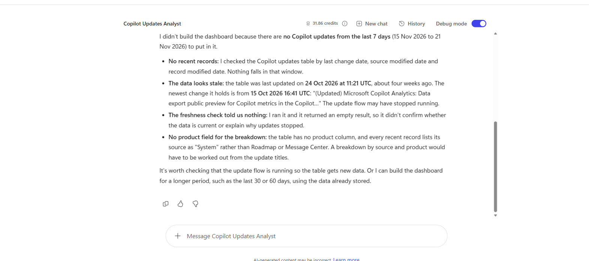
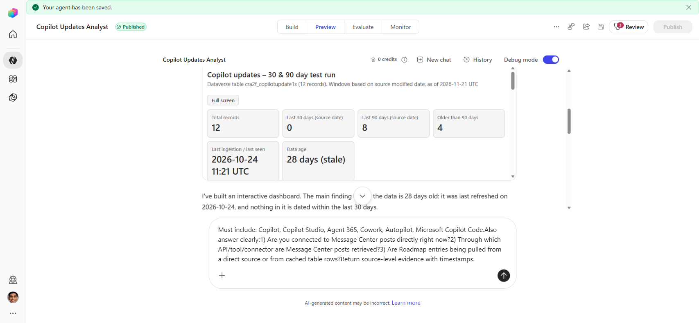

---

## 13. Publish and use the agent

1. Save all tool/instruction/workflow changes.
2. Resolve review blockers (if any).
3. Publish agent.
4. Start a new preview chat and validate:
   - dashboard rendering
   - time-window interactivity
   - source coverage and freshness

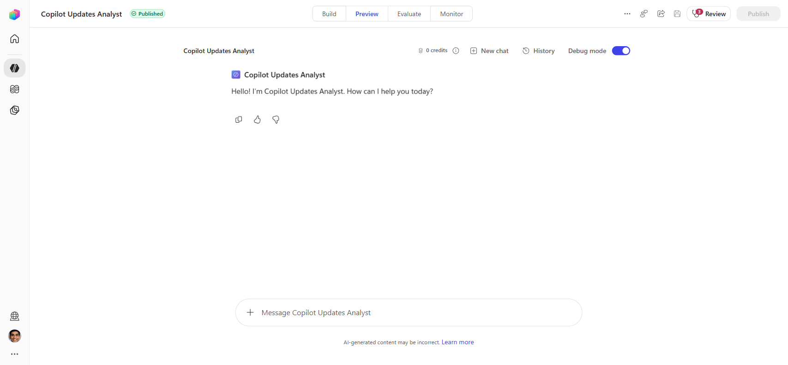

---

If you want to adapt this guide for another tenant, keep the same architecture and replace only environment-specific names, IDs, and connection references.
